# Second Nature Trail design package

Design proposal, 2026-11-09. The scope is in [scope.md](scope.md). Jim's subsequent build instruction authorizes implementation. Event date, spending authority, production hosting, content approvers, hardware baseline, and rehearsal attendees remain open. This document is not evidence that the game has passed release acceptance.

## Sequencing clarification · 2026-11-10

Jim directed that real testing follow the finished build. Continue implementation and developer verification without waiting for employee rehearsal, hardware/network testing, or event logistics. Keep the original functional scope and report those later release checks separately. Hosting account/domain/budget are publishing decisions; the drafted benefit questions can be reviewed with the finished game before the employee event.

## Experience

An original pixel neighborhood has been taken over by an officious AI. Employees restore homes through eight benefit-themed chapters. Bragging Square is the shared starting point. Every chapter opens for everyone simultaneously; stations have no exclusive queue. The world remains one shared instance.

Use Stardew Valley co-op as the movement/social comparison: readable top-down avatars, visible neighbors doing work, a small emote menu, and standings during a shared event. These are the interactions to compare during review, not assets to copy. The [official 1.4 changelog](https://www.stardewvalley.net/stardew-valley-1-4-update-full-changelog/) documents the emote menu, multiplayer event synchronization, and festival score visibility. This does not establish a capacity or accessibility baseline for this game.

## Annotated map

Layout aligned with the current content coordinates; exact screen coordinates belong to the renderer. Broad roads keep routes legible. Characters pass through one another. Each district has two separately labeled activity locations, a chapter number, and a completion indication that uses text as well as color.

```text
                        NORTH
 1. Moving depot       2. Filter warehouse      3. Identity bureau
    Broken highway        Ventilation maze        Counterfeit town hall

 4. Insurance office      BRAGGING SQUARE       5. Apartment block
    Disaster block        arrival / tutorial      Pest-control HQ
                          standings

 6. Trading post       7. Rewards arcade        8. Internet exchange
    Payment station       Night market            AI headquarters
                        SOUTH
```

District progress lights homes, clears road debris, and reduces the AI's on-screen control indicator. Optional secret interactions never expose a scored answer or competitive resource. The main route has explicit cargo/route decisions rather than hidden random punishment.

## Entry screens and controls

```text
Invitation -> capability/device check -> identity confirmation
           -> character/palette -> required insect choice
           -> text/motion/audio/control settings -> tutorial -> Ready
```

The phone/tablet screen precedes invitation consumption and character setup. It contains the exact scope warning, a copy-invitation button, event code, and support instructions. Narrow desktop windows get an enlarge-window message. Touch support alone cannot block a laptop.

The setup screen displays twelve original avatars, palette controls, and the exact question “Show spiders and insects?” Neither answer is selected. Pre-choice art is always safe. Replacement art applies immediately and to every view; the presentation always uses robots.

The tutorial asks players to move, interact, collect, answer, and request help. Each step needs a real action. Practice cannot alter competitive scores. Target ready time is three minutes for 9 of 10 representative employees; it has not yet been measured.

| Interaction | Keyboard | Pointer |
| --- | --- | --- |
| Movement | WASD/arrows | Destination click with pathfinding |
| Interact | E/Enter | Object/action click |
| Targeting | Arrows select, Space acts | Select target/action button |
| Quiz | Tab/Enter or 1–4, then confirm | Select answer, then confirm |
| Inventory/map/help | I/M/H | Persistent labeled buttons |
| Close | Escape | Visible close button |

Modal activities own arrow-key input only while focused. Closing help restores focus. Help says that the event clock continues. Gameplay bindings can be remapped with conflict checks. No required action depends on dragging, hovering, double clicking, rapid input, or holding two buttons.

## Chapter cards and inventory

Each card has a main task, optional harder challenge, two learning encounters, cooperative contribution, and secret. Each play window is five minutes, followed by two minutes of bragging. Main task balance target is roughly three minutes after practice.

| Chapter | Main interaction | Optional challenge direction | Learning subject |
| --- | --- | --- | --- |
| Move day mayhem | Choose useful cargo and a route | Choose a feasible bridge-capacity plan | Moving support and limits |
| The great filter shortage | Match filter to destination | Resolve swapped labels using measurements | Filter fit and replacement |
| Attack of the clones | Inspect clues and classify messages | Distinguish a convincing impostor | Identity protection and verification |
| RIP, my apartment | Prepare, then recover from a fictional disaster | Interpret fictional exclusion/deductible terms | Insurance scope and claims process |
| Pest resistance | Resolve eighteen timed targets at three sites; leave decoys | Identify the solid target from an authored clue | Reporting and treatment expectations |
| Credit where it's due | Plan simulated payments | Preserve budget through added expenses | Reporting and fictional credit model |
| Rewards rebellion | Inspect six unique jobs, earn tokens, and fund a neighborhood project | Evaluate expiration before using a reward | Earning and using rewards |
| Reconnect humanity | Visit three homes and build routes within relay/cost constraints | Identify a loop-free shared-relay plan | Internet setup and support |

Inventory has a fixed slot limit and published item values. Essential personal supplies prevent starvation. Barter requires both parties to confirm the current offer, and server commit is atomic. A changed inventory invalidates stale confirmation. Credits in the payment simulation cannot be traded. All prices, caps, penalties, primary and secondary metrics must be sourced from the versioned `content.mjs` ruleset rather than copied into independent UI constants.

## Awards

Allocate chapter prizes chronologically, then whole-event prizes in this order: hoarder, trailblazer, hero, intelligence, discovery, trader, survivor. Show raw winner and prize recipient separately. A previous winner remains in standings but cannot receive another prize. The final rules table must include fixed maximums, qualification thresholds, secondary metrics, seeded final tie breaking, and any fallback. No qualifying candidate means an explained unawarded prize unless a fallback was published before lobby opening.

Freeze all award inputs before the finale. The export must reconcile to this snapshot and recorded accepted actions. Finale actions use a separate meter and cannot change any prize input.

## Host states

```mermaid
stateDiagram-v2
  draft --> lobby: open lobby
  lobby --> countdown: confirm start
  countdown --> lobby: cancel before play
  countdown --> play: ten seconds, included in first play window
  play --> brag: play clock ends
  brag --> play: next chapter
  brag --> finale: chapter eight break ends; snapshot
  finale --> awards: four minutes
  awards --> closed: host closes
  play --> paused: pause
  brag --> paused: pause
  finale --> paused: pause
  paused --> play: resume saved play phase
  paused --> brag: resume saved break phase
  paused --> finale: resume saved finale phase
```



Pause retains the prior phase/time remaining and freezes scoring, inventory, trades, and competitive movement. Host loss does not pause the server. A skip invalidates the whole chapter for rankings and denominators, with the exception recorded. Operator identity, time, and reason accompany every host mutation. The backup sees the most recent control owner and action history.

## Finale storyboards

| Treatment | Four-minute sequence | Individual contribution clarity | Decision |
| --- | --- | --- | --- |
| Central utility | Gather at generator, repair sectors, switch on neighborhood | Contribution visible mainly in one central meter | Alternate considered |
| Reclaim AI headquarters | Enter lobby, disable consoles, evict AI | Clear console action; risks an extra navigation bottleneck | Alternate considered |
| Synchronize home repairs | Each player completes one repair; that home lights; shared meter rises; AI announces retirement | A visible home changes for each contribution | Recommended build treatment |

The home-repair finale uses 30 seconds of instruction, up to 150 seconds of contributions, and 60 seconds of celebration or the comic alternate ending. Contributions can finish early. A low-attendance event still ends by the four-minute deadline. Success threshold is frozen and visible at finale entry. Proposed alternate ending: the AI remains as the neighborhood's overly enthusiastic doorbell.

## Delivery estimate and assumptions

These are planning allowances, not a vendor quote, approved spending, or a claim about work already completed. A working automated build can arrive earlier; independent acceptance and content review still take people/time.

| Work | Planning allowance |
| --- | --- |
| Game implementation and integration | 120–200 engineering hours |
| Original art/audio refinement | 24–48 creative hours |
| Content integration and SN review | 12–24 hours across author and approvers |
| Accessibility, security, browser, recovery and balance testing | 40–64 hours |
| Event support and rehearsal | 8–16 operator/engineering hours |
| Deployment and handover | 8–16 hours |

Total proposed labor allowance: 212–368 hours. Apply the actual approved hourly rates to each role; no rates have been supplied. Hosting allowance for planning is $25–100 for an event month, subject to an actual provider quote, retention, monitoring, and load-test traffic. No purchase is authorized by this estimate. Production provider selection and pricing require fresh verification. Native Node HTTP plus SQLite is the current local implementation direction; production needs a single authoritative process, durable disk, TLS, backups, and documented restore. Do not deploy it onto an ephemeral filesystem or scale it to independent unsynchronized processes.
